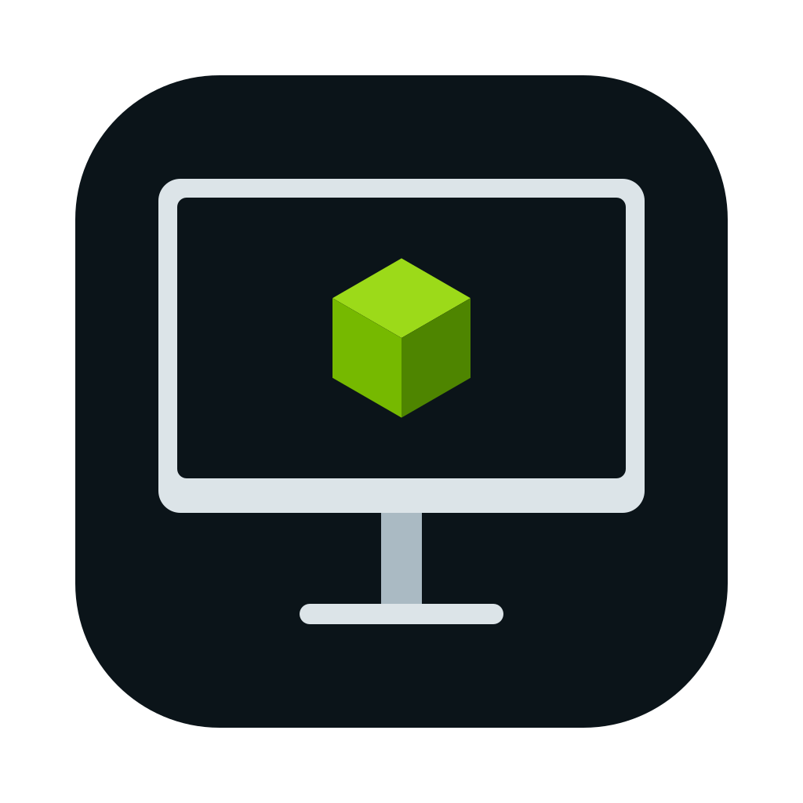

# Isaac Connect

Desktop viewer for NVIDIA Isaac Sim and Isaac Lab with remote launch and control features.

Connect your Mac to a Linux workstation, launch a simulation, and return to it
with automatic reconnect and saved connections.

**[Download for Apple silicon](https://github.com/inbarajaldrin/isaac-connect/releases/latest)** · macOS 14 or later

## Features

- Save and switch between workstations.
- View multiple streams in separate windows.
- Launch and stop Isaac Sim over SSH.
- Run custom launch profiles for Isaac Lab and other workflows.
- Reconnect automatically when the simulation restarts.
- Copy text from the remote Isaac interface to your Mac.

## Requirements

- An Apple silicon Mac running macOS 14 or later for the downloadable app.
- A Linux workstation with an Isaac Sim or Isaac Lab WebRTC stream.
- Key-based SSH and the Linux launcher for remote launch and stop controls.

## Get started

1. [Download the macOS app](https://github.com/inbarajaldrin/isaac-connect/releases/latest), unzip it, and drag **Isaac Connect** into **Applications**.
2. [Set up the Linux launcher](docs/SETUP.md#linux-workstation-isaac-ctl) for remote launch and stop.
3. Open **Isaac Connect**, then add your workstation in **Settings** (`⌘,`).
4. Choose **Workstation ▸ Launch** to start Isaac Sim, or connect to an existing stream.

Each streaming endpoint (host and port) can be open in one window at a time.

## Documentation

- [Using the viewer](docs/USAGE.md)
- [Installation and setup](docs/SETUP.md)
- [Build from source](docs/SETUP.md#build-from-source)
- [Isaac Lab launch profiles](docs/LAUNCH_PROFILES.md)
- [Linux launcher configuration](docs/LINUX_LAUNCHER.md)
- [Architecture and debugging](docs/ARCHITECTURE.md)
- [Building a release](docs/RELEASING.md)
- [Renderer provenance](docs/renderer-provenance.md)

## License

Original code and artwork are [MIT licensed](LICENSE). NVIDIA renderer components
and their dependencies retain their own terms; see [third-party notices](THIRD_PARTY_NOTICES.md).

Unofficial; not affiliated with or endorsed by NVIDIA. Isaac Sim and Isaac Lab
are NVIDIA products this app connects to.
